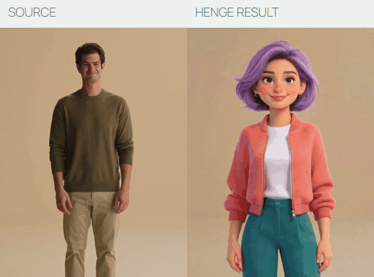
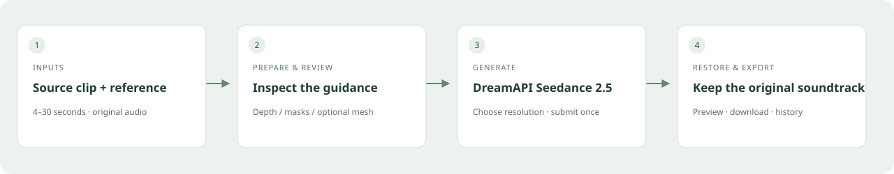
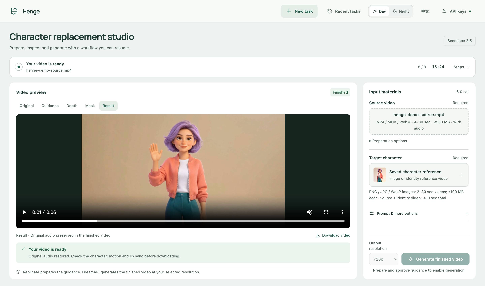
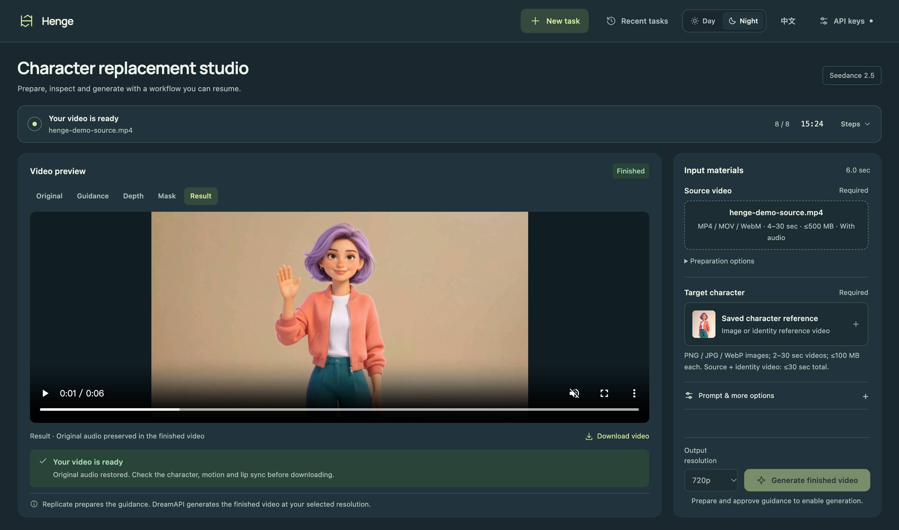

# Henge

**English** · [简体中文](README.zh-CN.md)

**An open-source workspace for AI video character replacement.**

Bring a short source clip and a character reference. Prepare motion guidance, inspect the mask, generate with **DreamAPI Seedance 2.5**, and export with the original soundtrack.

[Get started](#install-and-start) · [Workflow & verified example](docs/showcase.md) · [Roadmap](#roadmap) · [Report a problem](https://github.com/Hy-1990/Henge/issues)

> **Bring your own API keys.** The application runs locally; AI processing uses paid cloud services. You need DreamAPI and Replicate accounts with available credit. Start with a single clearly visible subject in a 4–30 second clip.

## See it in action

[](docs/assets/henge-x-en.mp4)

[Watch the 20-second demo](docs/assets/henge-x-en.mp4) · [Source clip](docs/assets/demo-source.mp4) · [Character reference](docs/assets/demo-reference.jpg) · [Uncut result](docs/assets/demo-result.mp4)

Original AI-generated actors; the comparison shows the actual output of one Henge replacement run. The promotional edit omits processing time.

## How it works



1. **Prepare** — upload the source clip and reference; build depth/mask or face-mesh guidance.
2. **Review** — inspect the entire guidance video and approve the current version.
3. **Generate** — choose a resolution, submit once, then preview and download with the original audio restored.

## Desktop workspace



<details>
<summary>Night appearance</summary>



</details>

## What you can use today

- **A desktop Studio:** large media preview, day/night appearance, English/Chinese interface, visible processing stages and recoverable tasks.
- **Three guidance methods:** Depth + SAM, Fast Face Mesh, and Depth + SAM + Face Mesh. Face-mesh methods require the optional worker.
- **Direct Seedance output:** DreamAPI integration for 480p, 720p and 1080p; no draft/upgrade step.
- **API keys on the page:** saved in macOS Keychain or Windows Credential Manager, rather than secret configuration files.
- **Review before generation:** approval is tied to the prepared input; saved task IDs support reconnecting after an interruption without automatically resubmitting a paid generation.
- **Original soundtrack:** restore the source video's first audio track locally; disclose small duration adjustments.

The app is a workflow and interface, not an open-source video generation model. Depth and vocal separation are provided by Replicate, along with the current SAM segmentation adapter; final video generation is provided by DreamAPI. Interface language changes never translate core workflow instructions or user-entered prompts.

## Roadmap

The following items are **proposals, not released features**:

- Agent-assisted conversation for editing a structured replacement plan.
- fal-powered point/box selection and per-shot mask corrections.
- Explicit character-to-image mapping and cross-shot human confirmation.

Automatic identity matching across cuts and pixel-perfect preservation of every non-target person are not currently guaranteed. See the [showcase and limitations](docs/showcase.md) before choosing footage.

## Install and start

### Windows: first installation

1. Install [Git for Windows](https://git-scm.com/download/win) and [Python 3.12](https://www.python.org/downloads/windows/). Include the **Python Launcher** and select **Add python.exe to PATH**.
2. Download the [Rubber Band Windows command-line utility](https://breakfastquay.com/rubberband/) (Windows executable). Extract it to a permanent folder, for example `C:\Tools\rubberband`. In Windows, open **Edit environment variables for your account**, edit the user `Path`, and add the folder containing `rubberband.exe`. Add the folder, not the ZIP or executable path.
3. Open a new PowerShell window and check both commands:

   ```powershell
   py -3.12 --version
   rubberband --version
   ```

4. In the folder where you want to keep the project, run:

   ```powershell
   git clone https://github.com/Hy-1990/Henge.git
   cd Henge
   .\setup.cmd
   .\start.cmd
   ```

5. Open **http://127.0.0.1:8771** after the server starts. Keep the terminal running. Stop with **Ctrl+C**.
6. Optional: stop the service, run `.\setup-face-mesh.cmd`, then restart with `.\start.cmd` to enable both face-mesh methods. Depth + SAM does not require this component. The Google Face Landmarker model downloads at first use.

### Windows: update an existing installation

Stop the old service with **Ctrl+C**, then run from the project folder:

```powershell
git pull
.\setup.cmd
.\start.cmd
```

For ZIP downloads, extract the latest GitHub ZIP into a new directory and follow the first-install instructions. Keep the old `runs/` folder, which may contain task history and media. Do not copy macOS `.venv` or `.venv-face` environments to Windows.

Refresh the browser, open **API keys**, enter and save the DreamAPI API Key and Replicate API Token separately. Both should show **Configured**. Keys are saved in the signed-in user's **Windows Credential Manager** and loaded on restart. No administrator access or configuration-file editing is required.

### Windows: daily use and troubleshooting

From the project folder:

```powershell
.\start.cmd
```

- Python or `py` not found: install Python 3.12 with the Python Launcher, then open a new terminal.
- `rubberband` not found: add the folder containing `rubberband.exe` to the user `Path`, open a new terminal, and repeat the version check.
- The page still mentions an unavailable macOS Keychain: update the code, stop and restart the old server, then refresh the page. That message comes from the old version.
- Native credential store unavailable: rerun `setup.cmd` as your signed-in user to install dependencies, then restart. `keyring` automatically installs its Windows backend dependency.
- Port 8771 in use: stop the old instance, or run `$env:PORT="8772"` in PowerShell before `.\start.cmd`, then open `http://127.0.0.1:8772`.

Windows support includes offline contract tests; a real Windows paid generation run has not yet been verified.

### macOS

Requires Python 3.12+ and Rubber Band. The optional mesh worker uses an isolated Python 3.12 environment.

```bash
git clone https://github.com/Hy-1990/Henge.git
cd Henge
brew install python@3.12 rubberband
PYTHON=python3.12 bash setup.sh
# Optional: enable the face-mesh methods
FACE_PYTHON=python3.12 bash setup-face-mesh.sh
bash start.command
```

Open **http://127.0.0.1:8771**. For later sessions, run `bash start.command` from the project folder. Use `PORT=8772 bash start.command` for another port. Stop with **Ctrl+C**.

On both systems, keep the local service running while processing. Closing the browser is fine; reopening a saved task retrieves its current state.

## First run

1. Open **API keys**.
2. Save your [DreamAPI key](https://api.newportai.com/) and [Replicate token](https://replicate.com/account/api-tokens). macOS may ask you to allow Python to access Keychain.
3. Add a **4–30 second source video with audio** (MP4/MOV/WebM, ≤500 MB) and a character reference (≤100 MB). The page checks format, size and readable duration before upload; the server checks the required audio track before starting paid preparation. Start with a single centered speaker.
4. Choose a guidance method and click **Prepare guidance**. This calls Replicate and incurs charges.
5. Inspect the entire guidance video. Approve it after checking hair, hands, clothing, background spill and face tracking. Depth methods can re-segment from the original footage, which makes another paid Replicate call.
6. Select resolution, review the prompt and click **Generate finished video**. This directly submits a paid DreamAPI generation.
7. Review and download the result. Original audio is restored locally.

Keys are stored in the current user's macOS Keychain or Windows Credential Manager. They are not stored in browser storage or returned by the server. Saving a key does not check the account balance or submit a paid generation.

## Limits and recovery

- Local single-user app, bound to localhost. One instance per project directory.
- Source upload limit 500 MB; each reference limit 100 MB. Reference images are PNG/JPEG/WebP. The primary reference may also be an MP4/MOV/WebM identity video.
- Identity reference videos can be 2–30 seconds; combined source and identity reference duration must be <=30 seconds, following the current DreamAPI reference-video limit.
- Source codecs must be decodable by PyAV and playable in the browser. Audio must be compatible with MP4 remuxing. H.264 + AAC in MP4 is the most portable input.
- Face-mesh methods target a single centered speaker. Full-clip visual approval is still required.
- The generation adapter follows the DreamAPI Seedance 2.5 multimodal input contract. Real-person reference support was confirmed by the platform owner. Output quality depends on the provider and inputs.
- Small output/source duration differences up to 1.1 seconds are aligned locally. Larger mismatches stop export rather than cutting the original soundtrack.
- If submission times out without a task ID, the interface blocks repeat submission. Check DreamAPI's task history and billing before deliberately creating another task.
- Preparation saves Replicate prediction IDs and completed artifacts. **Continue preparation** reconnects to the same cloud tasks and reuses completed steps after a local interruption. A fresh paid retry is offered only for a confirmed failed/canceled stage and requires an explicit click. An ambiguous submission blocks resubmission until provider history is checked.
- Original-footage mask repair preserves existing depth-mask coverage and fills enclosed holes locally. Inspect the full repaired guidance before approving it.
- Saved DreamAPI task IDs resume result collection; there is no automatic paid re-submission.
- Media and task metadata remain in `runs/` on this computer. Uploaded source derivatives and references are processed by Replicate/DreamAPI and their storage providers.

## Offline checks

```bash
.venv/bin/python -m unittest discover -s tests -v
.venv/bin/python test_composite.py
.venv-face/bin/python -c "import mediapipe, cv2, PIL, numpy"
```

Tests use isolated jobs and mocked providers. They verify secret handling, review invalidation, submission contracts, ambiguous submissions, collection recovery, source-audio packet preservation and duration alignment. They do not submit paid generations.

The initial release was locally checked on macOS ARM64, Python 3.14.3 with a Python 3.12 mesh worker. A live 29.9-second Depth + SAM / image-reference / 720p workflow has also been verified through generation, original-audio restoration, playback, download and same-task restart recovery; see [verification details](docs/verification.md). Other media, modes and resolutions still need their own quality checks.

## Attribution and license

Derived from [Sirio Berati's Genjustsu Open Source Workflow](https://github.com/sirioberati/Genjustsu-Open-Source-Workflow) at commit `40fd6615c2b7d940d4d7060e82de522292eefe99`. Upstream code remains under its [MIT license](LICENSE). Upstream example videos, names, logos and companion artwork are excluded from that grant and are not distributed here.

See [THIRD-PARTY.md](THIRD-PARTY.md) for dependency and hosted-model notices.
