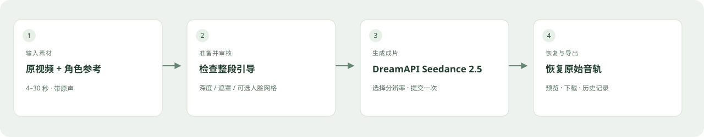
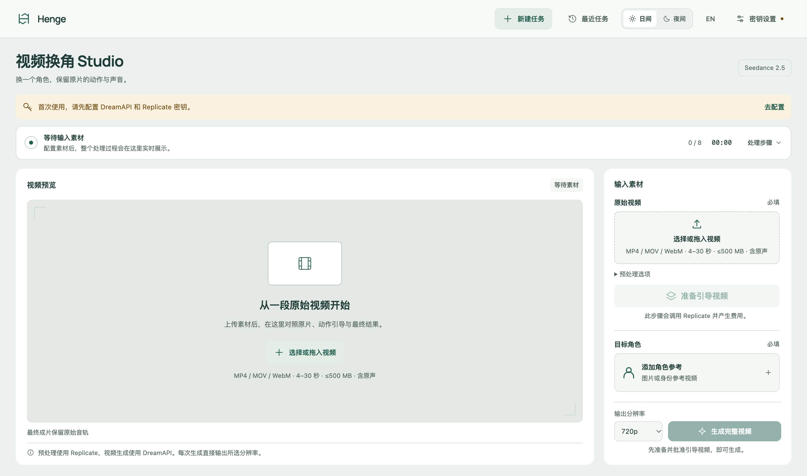
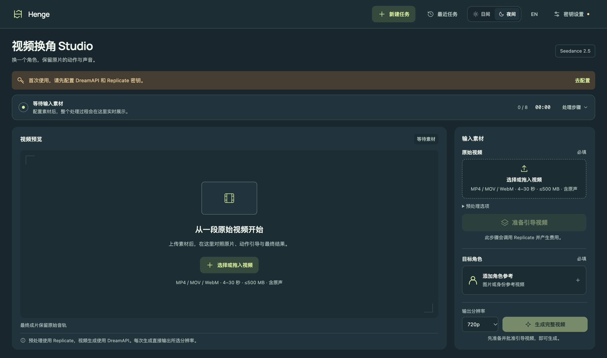

# Henge

[English](README.md) · **简体中文**

**开源 AI 视频角色替换工作台。**

提供一段原视频和目标角色参考，准备动作引导、检查遮罩，通过 **DreamAPI Seedance 2.5** 生成，再恢复原声并导出。

[开始使用](#安装与启动) · [流程与已验证案例](docs/showcase.zh-CN.md) · [路线图](#路线图) · [反馈问题](https://github.com/Hy-1990/Henge/issues)

> **需要自备 API 密钥。** 页面和媒体处理程序在本机运行，AI 推理由付费云服务完成。需要有可用余额的 DreamAPI、Replicate 账户。建议从单人清晰可见、带音轨的 4–30 秒素材开始。

## 三步完成换角



1. **准备**：上传原片与参考，制作深度/遮罩或人脸网格引导。
2. **检查**：预览整段引导，确认后批准当前版本。
3. **生成**：选择分辨率，提交一次生成，恢复原声后预览、下载。

## 桌面工作台



<details>
<summary>查看夜间外观</summary>



</details>

## 当前可用能力

- **PC 工作台**：大画面预览、日夜主题、中英文界面、可见处理步骤与任务恢复。
- **三种引导**：深度 + SAM、快速人脸网格、深度 + SAM + 人脸网格。网格模式需要安装可选组件。
- **直接输出成片**：接入 DreamAPI，选择 480p、720p 或 1080p，不经过草稿升级步骤。
- **页面配置密钥**：存入 macOS 钥匙串或 Windows 凭据管理器。
- **先检查再生成**：审批绑定已准备的输入；保存任务编号，断线后继续查询，不自动重复提交付费生成。
- **保留原声**：本地恢复源视频第一条音轨，小幅时长调整会明确提示。

开源的是工作流和交互界面，不是视频生成模型。当前深度、人声分离及 SAM 分割使用 Replicate，最终生成使用 DreamAPI。界面语言切换不会翻译核心工作流提示词或用户填写的提示词。

## 路线图

下面是**待讨论的规划，尚未上线**：

- Agent 对话调整结构化人物替换计划。
- 通过 fal 点选、框选人物，按镜头修正遮罩。
- 明确人物与参考图映射，跨镜头由用户确认目标身份。

当前不能保证自动跨镜头认出同一个人，也不能保证所有非目标人物逐像素不变。选素材前请先阅读[案例和限制](docs/showcase.zh-CN.md)。

## 安装与启动

### Windows：首次安装

1. 安装 [Git for Windows](https://git-scm.com/download/win) 和 [Python 3.12](https://www.python.org/downloads/windows/)。Python 安装时保留 **Python Launcher**，勾选 **Add python.exe to PATH**。
2. 下载 [Rubber Band 的 Windows 命令行工具](https://breakfastquay.com/rubberband/)（选择 Windows executable），解压到固定目录，例如 `C:\Tools\rubberband`。找到 `rubberband.exe` 所在文件夹，在 Windows 搜索中打开“编辑账户的环境变量”，编辑用户变量 `Path`，新增该文件夹的完整路径。不要只添加 ZIP 文件或 exe 文件路径。
3. 关闭并重新打开 PowerShell，检查下面两条命令都能显示版本：

   ```powershell
   py -3.12 --version
   rubberband --version
   ```

4. 在希望保存项目的目录打开 PowerShell，依次执行：

   ```powershell
   git clone https://github.com/Hy-1990/Henge.git
   cd Henge
   .\setup.cmd
   .\start.cmd
   ```

5. 看到服务启动后，在浏览器打开 **http://127.0.0.1:8771**。保持终端窗口运行；停止服务按 **Ctrl+C**。
6. 如需使用“快速人脸网格”或“深度 + 人脸网格”，停止服务后执行 ` .\setup-face-mesh.cmd`，安装完成再执行 `.\start.cmd`。只测试“深度 + SAM”无需安装此组件。首次使用网格模式时会下载 Google Face Landmarker 模型。

### Windows：已有项目更新（修复密钥配置报错）

先在旧服务终端按 **Ctrl+C**，然后在项目目录执行：

```powershell
git pull
.\setup.cmd
.\start.cmd
```

如果项目是通过 ZIP 下载的，请从 GitHub 下载最新 ZIP，解压到一个新目录，再按首次安装步骤运行。不要覆盖或删除旧目录里的 `runs/`，其中可能有历史任务和素材。不要将 macOS 的 `.venv` 或 `.venv-face` 复制到 Windows。

启动后刷新浏览器，打开**密钥设置**，分别填写 DreamAPI API Key 和 Replicate API Token 并保存。两项应显示“已配置”。Windows 使用当前登录用户的**凭据管理器**保存密钥，重启后自动读取，不需要管理员运行，也不需要修改配置文件。

### Windows：以后启动与常见问题

每次只需在项目目录运行：

```powershell
.\start.cmd
```

- `py` 或 Python 3.12 找不到：重新安装 Python 3.12 并包含 Python Launcher，重新打开终端。
- `rubberband` 找不到：检查用户 `Path` 是否包含 `rubberband.exe` 所在目录，重新打开终端后再次运行版本检查。
- 仍提示“无法访问 macOS 钥匙串”：确认已更新代码、停止旧后台并重新启动，再刷新页面；这是旧版本提示。
- 提示系统凭据库不可用：在当前登录用户下运行 `setup.cmd` 重新安装依赖，再重启。Windows 的凭据后端依赖会随 `keyring` 自动安装。
- 端口 8771 被占用：先关闭旧实例，或在 PowerShell 中执行 `$env:PORT="8772"` 后运行 `.\start.cmd`，再访问 `http://127.0.0.1:8772`。

Windows 适配包含离线契约测试；尚未完成真实 Windows 环境的整条付费生成验证。

### macOS

需要 Python 3.12 及以上版本和 Rubber Band。可选人脸网格组件使用独立的 Python 3.12 环境。

```bash
git clone https://github.com/Hy-1990/Henge.git
cd Henge
brew install python@3.12 rubberband
PYTHON=python3.12 bash setup.sh
# 可选：安装人脸网格组件
FACE_PYTHON=python3.12 bash setup-face-mesh.sh
bash start.command
```

打开 **http://127.0.0.1:8771**。以后只需在项目目录执行 `bash start.command`；更换端口可用 `PORT=8772 bash start.command`。按 **Ctrl+C** 停止。

两个系统处理任务时都需要保持本地服务运行。可以关闭浏览器；重新打开已保存任务后会显示当前进度。

## 首次使用

1. 打开**密钥设置**。
2. 保存你的 [DreamAPI 密钥](https://api.newportai.com/)和 [Replicate 密钥](https://replicate.com/account/api-tokens)。macOS 可能询问是否允许 Python 访问钥匙串。
3. 添加一段**带原声的 4–30 秒视频**（MP4/MOV/WebM，≤500 MB）和目标角色参考（≤100 MB）。页面提前检查格式、大小与可读时长；服务端会在启动付费预处理前检查音轨。建议先用单人居中口播。
4. 选择引导方式，点击**准备引导视频**。此步骤会调用 Replicate 并产生费用。
5. 检查整段引导视频，确认头发、手、服装、背景遮罩和人脸跟踪正确后批准。深度模式可以使用原片重新分割，此操作会再次调用 Replicate 并计费。
6. 选择分辨率、检查提示词，点击**生成完整视频**。此步骤会直接提交 DreamAPI 付费生成任务。
7. 检查并下载成片，程序会在本地恢复原始音轨。

密钥只写入当前系统用户的 macOS 钥匙串或 Windows 凭据管理器。浏览器不保存密钥，服务端不通过接口返回密钥内容。保存密钥不会验证余额或发起付费生成。

## 使用限制与恢复

- 本地单用户应用，仅监听本机地址。同一个项目目录同时运行一个实例。
- 原视频上限为 500 MB，每份参考上限为 100 MB。支持 PNG、JPEG、WebP 参考图，主角色也可以使用 MP4、MOV 或 WebM 身份参考视频。
- 身份参考视频为 2–30 秒；按当前 DreamAPI 视频参考限制，原片与身份参考视频的时长总和不能超过 30 秒。
- 源视频需要能被 PyAV 解码并在浏览器中播放，音轨需要支持封装到 MP4。H.264 视频和 AAC 音轨的 MP4 兼容性最好。
- 人脸网格适合单人居中口播，仍需检查并批准整段引导。
- 生成适配器按照 DreamAPI 技能文档中的 Seedance 2.5 多模态输入协议实现。平台所有者已确认支持真人参考，实际效果取决于模型和素材。
- 生成视频与原片不超过 1.1 秒的时长差会在本地对齐。更大的偏差会停止导出，保留原始音轨。
- 提交超时且没有返回任务编号时，界面会阻止重复提交。请先在 DreamAPI 核对任务和计费记录，再决定是否新建任务。
- 预处理会保存 Replicate 任务编号与已完成文件。本地中断后，点击**继续准备引导**会继续获取同一任务并复用已完成步骤；只有确认失败或取消的步骤才提供付费重试入口，需明确点击。提交结果不明时会阻止再次提交，避免重复计费。
- 原片遮罩修复会保留已有深度遮罩的覆盖范围，并在本地补齐内部孔洞；修复后仍需检查整段引导再批准。
- DreamAPI 任务编号可用于继续获取结果，不会自动重新提交付费生成。
- 视频和任务记录保留在当前电脑 的 `runs/` 目录。上传的处理素材和参考图会交由 Replicate、DreamAPI 及其存储服务处理。

## 本地验证

```bash
.venv/bin/python -m unittest discover -s tests -v
.venv/bin/python test_composite.py
.venv-face/bin/python -c "import mediapipe, cv2, PIL, numpy"
```

测试使用独立任务目录和模拟云端服务，验证密钥处理、审批失效、提交协议、不确定提交、结果恢复、原始音轨数据包保留和时长对齐，不会提交付费生成。

初版已在 macOS ARM64、Python 3.14.3 和 Python 3.12 人脸网格环境中完成本地验证。另已通过一次 29.9 秒、深度 + SAM、图片身份参考、720p 的真实云端测试，验证生成、原声恢复、播放、下载和重启后继续同一任务；见[验证记录](docs/verification.md)。其他素材、模式与分辨率仍需分别验证效果。

## 来源与许可

基于 [Sirio Berati 的 Genjustsu 开源工作流](https://github.com/sirioberati/Genjustsu-Open-Source-Workflow)，对应提交 `40fd6615c2b7d940d4d7060e82de522292eefe99`。上游代码保留其 [MIT 许可](LICENSE)。上游示例视频、名称、标志和配套品牌插图不在该许可授权范围内，本项目不包含这些资产。

第三方依赖和托管模型说明见 [THIRD-PARTY.md](THIRD-PARTY.md)。
