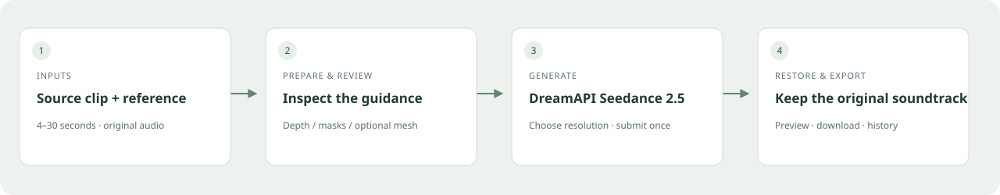

# Workflow showcase

**English** · [简体中文](showcase.zh-CN.md)

## What the workflow does

A short source video provides the motion and scene. A character image or supported identity video supplies the replacement identity. The workflow prepares visual guidance, pauses for human review, submits it to DreamAPI Seedance 2.5 and restores the original soundtrack locally.

## Verified example

One single-subject, image-reference, Depth + SAM workflow was completed and checked at **720p**:

| Item | Observed result |
|---|---|
| Source duration | 29.895 seconds |
| Generated video | 720 × 1280, 24 fps |
| Aligned export | 717 video frames |
| Original soundtrack | All 1,289 compressed audio packets matched the source |
| Recovery | Restart continued the saved generation task instead of submitting another |

This is evidence for one workflow, not a general success-rate benchmark. Fine identity resemblance, lip sync and motion fidelity still require visual review. See [verification notes](verification.md).

## Public demonstration video

[English launch video](assets/henge-x-en.mp4) · [Chinese launch video](assets/henge-x-zh-CN.mp4)

The demo uses original fictional actors generated for Henge. One 6.08-second source was processed through the current Depth + SAM workflow and replaced using the supplied character image. The 1280 × 720 export has 145 video frames, and all 191 compressed audio packets match the source.

[Source](assets/demo-source.mp4) · [Reference](assets/demo-reference.jpg) · [Reviewed guidance](assets/demo-guidance.mp4) · [Uncut result](assets/demo-result.mp4)

The 20-second promotional edit shows the actual before/after comparison and guidance UI. Waiting time is omitted. The planned Agent/fal prototype is not presented as a released feature. Private test footage and upstream example media are not distributed.

## Accounts, cost and waiting

The local application is open source. Cloud processing is billed separately by your providers:

| Service | Used for |
|---|---|
| Replicate | Vocal separation, depth estimation and current SAM segmentation |
| DreamAPI | Media storage/upload integration and Seedance generation; consult the provider for billing details |

No validated, itemized dollar-cost comparison has been published yet. Provider queues, clip length and output resolution affect waiting and billing; no speed or savings guarantee is made. A successful status request does not mean generation is finished. Keep the local service running during processing.

## Choose footage carefully

Start with one clearly visible person and a single continuous shot. Inspect the entire mask, especially hands, hair, clothing and overlapping people. The default `person` segmentation can select several people. The current app does not provide interactive point/box selection or automatic cross-shot identity confirmation. These are planned improvements.

Source clips must be 4–30 seconds with audio. Image references avoid consuming the combined video-reference duration budget; see the README for all upload limits. Use source and reference material suitable for your intended publication.
