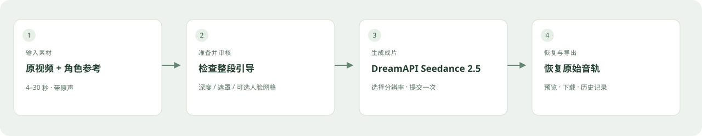

# 工作流展示

[English](showcase.md) · **简体中文**

## 这个工作流做什么

原视频提供动作与场景，角色图片或支持的身份参考视频提供目标身份。程序制作视觉引导，暂停等待人工检查，提交 DreamAPI Seedance 2.5 生成，并在本地恢复原始音轨。

## 已验证案例

已完成一次**单主体、图片参考、深度 + SAM、720p** 工作流验证：

| 项目 | 实际记录 |
|---|---|
| 原片时长 | 29.895 秒 |
| 生成画面 | 720 × 1280，24 fps |
| 对齐后的导出画面 | 717 帧 |
| 原始音轨 | 全部 1,289 个压缩音频包与原片一致 |
| 任务恢复 | 重启后继续原生成任务，没有重新提交 |

这只证明一个案例跑通，不代表所有素材的成功率。人物相似度、口型和动作保真仍需要人工观察。详见[验证记录](verification.md)。

## 公开演示视频

[英文宣传片](assets/henge-x-en.mp4) · [中文宣传片](assets/henge-x-zh-CN.mp4)

演示采用为 Henge 原创生成的虚构人物。6.08 秒原片经过当前“深度 + SAM”流程，用指定角色参考执行替换。1280 × 720 导出含 145 帧画面，全部 191 个压缩音频包与原片一致。

[原视频](assets/demo-source.mp4) · [角色参考](assets/demo-reference.jpg) · [已审核引导](assets/demo-guidance.mp4) · [完整成片](assets/demo-result.mp4)

20 秒宣传片展示实际前后对比与引导审核界面，省略等待时间。规划中的 Agent/fal 原型不作为当前已上线功能展示。私人测试素材和上游示例媒体不随仓库发布。

## 账户、费用和等待

本地应用开源，云端处理由各服务商单独计费：

| 服务 | 用途 |
|---|---|
| Replicate | 人声分离、深度估计、当前 SAM 分割 |
| DreamAPI | 媒体上传/存储接入和 Seedance 生成；具体计费以服务商为准 |

目前尚未发布经核对的分项美元成本对比。排队、片长、输出分辨率会影响等待与费用，不保证速度或节省比例。状态请求成功不等于视频已经生成完成；处理时请保持本地服务运行。

## 适合先用什么素材

建议从单人清晰可见、没有切镜头的短片开始。检查整段遮罩，尤其是手、头发、衣服及人物交叠处。默认 `person` 可能选中多个人。当前版本没有点选/框选人物或自动跨镜头确认身份，这些属于规划能力。

原片需要带音轨，时长为 4–30 秒。角色图片不占用视频参考的合计时长额度；完整限制见 README。请使用适合预期公开用途的原片与角色素材。
